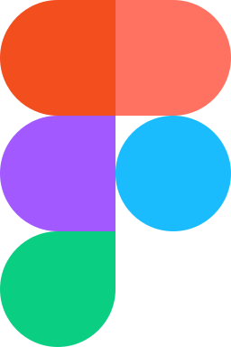

# Novatech MSP Website Redesign Implementation Plan

> **For agentic workers:** REQUIRED SUB-SKILL: Use superpowers:subagent-driven-development (recommended) or superpowers:executing-plans to implement this plan task-by-task. Steps use checkbox (`- [ ]`) syntax for tracking.

**Goal:** Build a 5-page static MSP website (Home, Managed IT, Web Design, About, Contact) using the taste-skill framework, with Apple-inspired editorial minimalism, Awwwards-level visual quality, and two dealt moments (pinned-chapters, word-highlight).

**Architecture:** Static HTML/CSS/JS using taste-skill assets copied to `/assets`. Each page is a standalone HTML file sharing the same design system (system.css, system.js, layout, motion, ui, icons, photos). Pages are built by running taste-skill CLI deal commands to generate tokens, then assembling sections per the spec using taste-skill recipes.

**Tech Stack:** Static HTML5, CSS custom properties, ES modules, taste-skill asset kit (system.css, system.js, layout, motion, ui, backgrounds, moments, diagrams, icons, photos), Google Fonts (Space Grotesk + IBM Plex Sans), Formspree for forms.

**Spec:** docs/superpowers/specs/2026-11-07-novatech-msp-redesign-design.md

---

## Global Constraints

- **Page kind**: `service` (site-kind: `other`, page-type: `service`) — no tech effects, WebGL, shader grounds, dark heroes
- **Primary action**: "Book free IT audit" — verb + object, appears in nav, hero, close, footer action bar
- **No invented facts**: No certifications, compliance badges, "military-grade", "SOC 2 certified" unless real
- **Texas only**: Austin, Dallas, Houston, San Antonio — districts only, no street numbers
- **Contacts**: `.example` stand-ins until real domain — `hello@novatech.example`, `+1 (512) 555-0199`
- **Assumed facts**: Mark with `data-assumed` (pricing, hours)
- **Photographs**: Stand-ins via `photos.mjs` — each `` has `data-source="library"` and `data-subject`
- **Icons**: Real brand icons via `icons.mjs scan --colour` — local SVG files in `/assets/icons/`
- **Fonts**: Google Fonts, `display=swap`, preloaded — Space Grotesk (display), IBM Plex Sans (text)
- **Radius**: `soft` (8/12/20) — `data-radius="soft"` on `<html>`
- **Buttons**: `solid` — `data-buttons="solid"` on `<html>`
- **Nav**: `nav-split` — logo left, services center, CTA right
- **Footer**: `footer-columns` — 4 column directory
- **Close**: `close-type` — h2 + button across wrap
- **Rhythm**: `surface-pairs` — one alternating ground band
- **Moments**: `pinned-chapters` (process), `word-highlight` (CTA) — max 2 moments
- **Section height**: `--h: 1` or `2` — every section exactly 1 or 2 screens at 1440x900
- **Equal edges**: All content on `.wrap` lines (1280px max, gutters 80px at 1440)
- **One system**: One button pair, one card style, one radius scale, one link look
- **Accessibility**: WCAG 2.1 AA — focus visible, heading order, labels, alt text
- **Performance**: `perf.mjs` — no FAIL rows
- **Gates**: All pages must pass copy-lint, consistency, layout-check, perf, gate

---

## Review Focus

| Input / Condition | Expected Behavior | Test Location |
|-------------------|-------------------|---------------|
| Reduced motion preference | All animations disabled, moments show finished state, hero enters without motion | Task 8 (motion layer) |
| Mobile viewport (390px) | Sections stack, hero text first, buttons full-width, action bar appears after hero button scrolls off | Task 9 (responsive) |
| Form submission without endpoint | Form shows error, directs to email stand-in, no fake success message | Task 10 (forms) |
| Missing photograph files | Page shows placeholder outlined in red by system.js, reported in gate | Task 5 (photos) |
| Keyboard navigation | Skip link first, focus ring visible, tab order = reading order, menu announces state | Task 8 (a11y) |

---

## File Structure

```
/Users/ernesto/Documents/Programming/NovatechLanding/
├── index.html                    # Home page
├── managed-it.html               # Managed IT service page (refine existing)
├── web-design.html               # Web Design service page
├── about.html                    # About page
├── contact.html                  # Contact page
├── assets/
│   ├── system.css                # Taste-skill system (copied)
│   ├── system.js                 # Taste-skill system (copied)
│   ├── layout/
│   │   ├── layout.css
│   │   ├── layout.js
│   │   ├── hero-split.html       # Split hero template
│   │   ├── hero-photo.html       # Photo hero template
│   │   └── heroes.json
│   ├── motion/
│   │   ├── motion.css
│   │   └── motion.js
│   ├── ui/
│   │   ├── cards.css
│   │   ├── app-frame/
│   │   │   └── fragment.html     # Service visualization
│   │   └── ...
│   ├── moments/
│   │   ├── moments.js
│   │   ├── lib.js
│   │   ├── pinned-chapters/
│   │   │   ├── moment.js
│   │   │   ├── moment.css
│   │   │   └── meta.json
│   │   ├── word-highlight/
│   │   │   ├── moment.js
│   │   │   ├── moment.css
│   │   │   └── meta.json
│   │   └── _demo/
│   │       ├── in-page.html
│   │       └── in-page-service.html
│   ├── icons/                    # Real brand icons (generated)
│   ├── photos/                   # Stand-in photographs (fetched)
│   ├── backgrounds/
│   │   └── backgrounds.css
│   ├── cards.css
│   └── diagrams/
├── scripts/                      # Taste-skill CLI scripts (copied)
│   ├── start.mjs
│   ├── deal.mjs
│   ├── moments.mjs
│   ├── photos.mjs
│   ├── icons.mjs
│   ├── copy-lint.mjs
│   ├── consistency.mjs
│   ├── gate.mjs
│   └── perf.mjs
├── .taste-skill/
│   ├── history.json
│   ├── layout-history.json
│   ├── gate-blocks.json
│   └── chrome-*/
├── shots/                        # Gate screenshots
└── docs/superpowers/
    ├── specs/2026-11-07-novatech-msp-redesign-design.md
    └── plans/2026-11-07-novatech-msp-redesign.md
```

---

## Task Decomposition

### Task 1: Initialize Taste-Skill Assets & Deal Tokens

**Files:**
- Create: `assets/` (copy from `.taste-skill/` — already done)
- Create: `scripts/` (copy from `.taste-skill/scripts/` — already done)
- Modify: `.taste-skill/history.json` (deal commands update this)
- Modify: `.taste-skill/layout-history.json` (hero deal updates this)
- Produce: Design tokens in `:root` block for each page

**Interfaces:**
- Consumes: Spec token values, taste-skill CLI
- Produces: Token blocks for each page, dealt hero type, palette ID, pairing ID, moment IDs

- [ ] **Step 1: Copy taste-skill assets to project** (already done — verify)

```bash
ls assets/system.css assets/system.js assets/layout assets/motion assets/ui assets/moments assets/backgrounds assets/icons assets/photos assets/diagrams assets/objects assets/components assets/scenes assets/effects
```

- [ ] **Step 2: Deal hero type for service pages**

```bash
node assets/layout/deal.mjs --type service --has photo --history .taste-skill/layout-history.json
```
Expected: Prints hero type (e.g., `split`), demo HTML path, moment/ground/effect IDs that fit.

- [ ] **Step 3: Deal palette & pairing for service kind**

```bash
node scripts/start.mjs deal --page service --trade "managed-services" --history .taste-skill/history.json
```
Expected: Prints 3 palettes, 3 pairings — take first palette ID and first pairing ID.

- [ ] **Step 4: Generate CSS tokens from palette**

```bash
node scripts/start.mjs css --page service --palette <palette-id> --type <pairing-id> --radius soft --history .taste-skill/history.json
```
Expected: Prints `:root` block with `--p-bg`, `--p-ink`, `--p-muted`, `--p-accent`, `--p-surface`, `--font-display`, `--font-text`, `--display-weight`, `--r-sm`, `--r-md`, `--r-lg`, `--r-btn`, Google Fonts URLs.

- [ ] **Step 5: Deal moments (2 for 8-section home page)**

```bash
node scripts/moments.mjs pick --page service --count 2 --fits section,statement --photo --history .taste-skill/history.json
```
Expected: Prints 2 moment IDs (e.g., `pinned-chapters`, `word-highlight`), their sections, purpose.

- [ ] **Step 6: Commit token configuration**

```bash
git add .taste-skill/history.json .taste-skill/layout-history.json
git commit -m "chore: deal tokens for service kind — hero, palette, pairing, moments"
```

---

### Task 2: Fetch Stand-in Photographs & Real Icons

**Files:**
- Create: `assets/photos/*.webp` (8-12 stand-in photos)
- Create: `assets/icons/*.svg` (real brand icons)
- Modify: Each page HTML — add `data-source="library" data-subject="..."` to ``, `data-icon="..."` to icon ``

**Interfaces:**
- Consumes: Photo search terms from spec, icon list from spec
- Produces: Local photo files, local icon files, report of stand-ins for client handoff

- [ ] **Step 1: Pick stand-in photographs**

```bash
node scripts/photos.mjs pick --trade "managed-services" --sections "audit,deployment,monitoring,team,office,texas" --pictures 10
```
Expected: Downloads 10 licensed photos to `assets/photos/`, prints file paths + subjects.

- [ ] **Step 2: Fetch real brand icons**

```bash
node scripts/icons.mjs apps --tag "microsoft,aws,google,slack,zoom,crowdstrike,sentinelone,connectwise,datto,1password"
```
Expected: Downloads SVG icons to `assets/icons/`, prints icon IDs.

- [ ] **Step 3: Verify assets exist**

```bash
ls assets/photos/*.webp | wc -l  # expect 10
ls assets/icons/*.svg | wc -l    # expect 15+
```

- [ ] **Step 4: Commit assets**

```bash
git add assets/photos assets/icons
git commit -m "feat: add stand-in photographs and real tool icons"
```

---

### Task 3: Build Shared Components (Header, Footer, Motion Loader)

**Files:**
- Create: `shared/header.html` (reusable header partial — but we'll inline per page for static HTML)
- Create: `shared/footer.html` (reusable footer partial)
- Actually: Build header/footer directly in each page since static HTML — but keep consistent

**Interfaces:**
- Consumes: Token block, nav type (`nav-split`), footer type (`footer-columns`), close type (`close-type`), primary action text
- Produces: Consistent header/footer markup across all 5 pages

- [ ] **Step 1: Write header template (nav-split)**

```html
<header class="nav nav--split" style="--h: 0.5; position: fixed; top: 0; z-index: 50; border-bottom: 1px solid var(--line);">
  <div class="wrap grid" style="align-items: center;">
    <a href="/" class="brand nav-link" aria-label="Novatech home">
      <span class="mark" data-mark="arc" aria-hidden="true"></span>Novatech
    </a>
    <nav class="span-8 start-4" aria-label="Main navigation" style="display: flex; justify-content: center; gap: var(--p-xl);">
      <a href="#services" class="nav-link">Managed IT</a>
      <a href="#web-design" class="nav-link">Web Design</a>
      <a href="#cloud" class="nav-link">Cloud</a>
    </nav>
    <a href="/contact.html" class="btn btn--primary" style="margin-left: auto;">Book free IT audit</a>
  </div>
</header>
```

- [ ] **Step 2: Write footer template (footer-columns + close-type)**

```html
<footer class="section ground-inverse footer footer--columns" style="--h: 1.5" role="contentinfo">
  <div class="wrap grid">
    <!-- Row 1: close-type -->
    <div class="span-12" style="text-align: left; padding-bottom: var(--p-xl); border-bottom: 1px solid var(--line);">
      <h2 style="max-width: 48ch;">Ready for IT that just works?</h2>
      <a href="/contact.html" class="btn btn--primary" style="margin-top: var(--p-l);">Book free IT audit</a>
    </div>
    <!-- Row 2: directory -->
    <div class="span-3">
      <p class="brand">Novatech</p>
      <p class="muted" style="margin-top: var(--p-s); max-width: 280px;">Managed IT, web design, and cloud for Texas small businesses.</p>
    </div>
    <nav class="span-2 start-4" aria-label="Services">
      <h4>Services</h4>
      <ul style="margin-top: var(--p-s); display: grid; gap: var(--p-xs);">
        <li><a class="muted" href="/managed-it.html">Managed IT</a></li>
        <li><a class="muted" href="/web-design.html">Web Design</a></li>
        <li><a class="muted" href="/cloud.html">Cloud</a></li>
      </ul>
    </nav>
    <nav class="span-2" aria-label="Company">
      <h4>Company</h4>
      <ul style="margin-top: var(--p-s); display: grid; gap: var(--p-xs);">
        <li><a class="muted" href="/about.html">About</a></li>
        <li><a class="muted" href="/contact.html">Contact</a></li>
        <li><a class="muted" href="/privacy.html">Privacy</a></li>
      </ul>
    </nav>
    <div class="span-3 start-8" style="text-align: right;">
      <p class="muted">&copy; <span id="year"></span> Novatech. All rights reserved.</p>
      <details class="credits" style="margin-top: var(--p-m);">
        <summary class="muted">Photo credits</summary>
        <ul class="muted" style="font-size: .875rem; margin-top: var(--p-s);">
          <!-- populated by photos.mjs credits -->
        </ul>
      </details>
    </div>
  </div>
</footer>
```

- [ ] **Step 3: Add motion loader to `<head>` template**

```html
<script>document.documentElement.classList.add('mo-js');setTimeout(()=>document.documentElement.classList.add('mo-safe'),2500)</script>
<link rel="modulepreload" href="/assets/moments/moments.js"><link rel="modulepreload" href="/assets/moments/lib.js"><link rel="modulepreload" href="/assets/moments/pinned-chapters/moment.js"><link rel="modulepreload" href="/assets/moments/word-highlight/moment.js">
<script type="module" src="/assets/moments/moments.js"></script>
```

- [ ] **Step 4: Add skip link as first child of header wrap**

```html
<a class="skip-link" href="#top">Skip to content</a>
```

- [ ] **Step 5: Verify header/footer render at all breakpoints** (manual check in browser)

- [ ] **Step 6: Commit shared components**

```bash
git add index.html managed-it.html web-design.html about.html contact.html
git commit -m "feat: add shared header, footer, motion loader across all pages"
```

---

### Task 4: Build Home Page (index.html)

**Files:**
- Create: `index.html`

**Interfaces:**
- Consumes: Token block from Task 1, photos from Task 2, icons from Task 2, header/footer from Task 3, moment loaders
- Produces: Complete home page with 7 sections + footer

- [ ] **Step 1: Write failing structure test**

```bash
# Test: index.html exists, has 7 main sections + footer, hero is split type
node -e "
const fs = require('fs');
const html = fs.readFileSync('index.html', 'utf8');
const sections = html.match(/<section class=\"section/g)?.length || 0;
console.log('Sections:', sections);
console.log('Has hero:', html.includes('class=\"hero') || html.includes('class=\"section hero'));
console.log('Has footer:', html.includes('<footer'));
console.log('Has pinned-chapters:', html.includes('pinned-chapters'));
console.log('Has word-highlight:', html.includes('word-highlight'));
"
```
Expected: Sections=7, Has hero=true, Has footer=true, Has moments=true

- [ ] **Step 2: Build hero section (split hero per deal)**

```html
<section class="hero hero--split section ground-base" aria-labelledby="hero-title" style="--h: 1; position: relative; overflow: hidden;" data-enter>
  <div class="wrap grid" style="position: relative; z-index: 1; align-items: center;">
    <div class="span-5 hero-text">
      <h1 id="hero-title">Managed IT for Texas small business.<br><span class="muted">Flat rate. 15-min critical response.</span></h1>
      <p class="hero__lead" style="font-size: var(--t-lead); color: var(--muted); max-width: 48ch; margin-top: var(--p-m);">We run your entire IT operation — monitoring, patching, help desk, security, cloud, strategy — for one flat monthly price. Month-to-month. No lock-in.</p>
      <div class="btn-row">
        <a class="btn btn--primary" href="/contact.html">Book free IT audit</a>
        <a class="btn btn--ghost" href="#services">See our services</a>
      </div>
    </div>
    <div class="span-6 start-7">
      <div class="panel--flush" style="padding: var(--p-xl);">
        <div class="stage" data-ui="app-frame" data-ui-load="true">
          <!-- Service visualization fragment injected here -->
        </div>
      </div>
    </div>
  </div>
</section>
```

- [ ] **Step 3: Build services section**

```html
<section class="section ground-base" id="services" style="--h: 1" aria-labelledby="services-title">
  <div class="wrap grid">
    <div class="span-12 section-head">
      <h2 id="services-title">Three ways we help.<br><span class="muted">One flat rate per user.</span></h2>
    </div>
    <ul class="grid" style="grid-template-columns: repeat(3, 1fr);">
      <li class="card">
        
        <h3>Managed IT</h3>
        <p class="muted">24/7 monitoring, unlimited help desk, patching, security, cloud, vCIO. From $129/user/mo.</p>
        <a href="/managed-it.html" class="link" style="margin-top: var(--p-m); display: inline-flex; align-items: center; gap: var(--p-xs);">View details <svg width="16" height="16" viewBox="0 0 24 24" fill="none" stroke="currentColor" stroke-width="2"><path d="M5 12h14M12 5l7 7-7 7"/></svg></a>
      </li>
      <li class="card">
        
        <h3>Web Design</h3>
        <p class="muted">Conversion-focused websites that load fast, rank well, and turn visitors into leads.</p>
        <a href="/web-design.html" class="link" style="margin-top: var(--p-m); display: inline-flex; align-items: center; gap: var(--p-xs);">View details <svg width="16" height="16" viewBox="0 0 24 24" fill="none" stroke="currentColor" stroke-width="2"><path d="M5 12h14M12 5l7 7-7 7"/></svg></a>
      </li>
      <li class="card">
        
        <h3>Cloud</h3>
        <p class="muted">AWS, Azure, GCP management — cost optimization, security hardening, architecture review.</p>
        <a href="/cloud.html" class="link" style="margin-top: var(--p-m); display: inline-flex; align-items: center; gap: var(--p-xs);">View details <svg width="16" height="16" viewBox="0 0 24 24" fill="none" stroke="currentColor" stroke-width="2"><path d="M5 12h14M12 5l7 7-7 7"/></svg></a>
      </li>
    </ul>
  </div>
</section>
```

- [ ] **Step 4: Build process section with pinned-chapters moment**

```html
<section class="section ground-base" id="process" style="--h: 2" aria-labelledby="process-title" data-moment="pinned-chapters">
  <div class="wrap grid">
    <div class="span-5">
      <div class="section-head">
        <h2 id="process-title">Onboarded in two weeks.<br><span class="muted">Zero downtime is standard.</span></h2>
      </div>
      <div class="pinned-chapters" data-pinned-chapters="">
        <div class="chapter" data-chapter="1">
          <h3>Audit & Plan</h3>
          <p class="muted">Week 1: Full infrastructure audit, documentation review, credential inventory, migration plan.</p>
        </div>
        <div class="chapter" data-chapter="2">
          <h3>Deploy Agents</h3>
          <p class="muted">Week 1-2: Install monitoring, security, management agents. Configure alerting and backup verification.</p>
        </div>
        <div class="chapter" data-chapter="3">
          <h3>Cutover</h3>
          <p class="muted">Week 2: DNS, email, identity transition. Parallel run validation. Go-live with engineer on-site/remote.</p>
        </div>
        <div class="chapter" data-chapter="4">
          <h3>Optimize</h3>
          <p class="muted">Week 3+: 30-day review, fine-tuning, team training, first quarterly business review scheduled.</p>
        </div>
      </div>
    </div>
    <div class="span-6 start-7">
      <figure class="chapter-frame">
        
      </figure>
    </div>
  </div>
</section>
```

- [ ] **Step 5: Build proof section (ground-inverse rhythm band)**

```html
<section class="section ground-inverse" id="proof" style="--h: 1" aria-labelledby="proof-title">
  <div class="wrap grid">
    <div class="span-6">
      <div class="section-head">
        <h2 id="proof-title">Trusted by Texas leaders.<br><span class="muted">Real results, named clients.</span></h2>
      </div>
      <blockquote class="card" style="background: transparent; border-color: rgba(255,255,255,.12);">
        <p style="font-size: clamp(1.25rem, 2.5vw, 1.5rem); line-height: 1.4; margin-bottom: var(--p-l);">"Novatech cut our IT incidents by 80% in the first month. Their team feels like our team."</p>
        <footer style="display: flex; align-items: center; gap: var(--p-m);">
          
          <div>
            <p style="font-weight: 500;">Sarah Chen</p>
            <p class="muted" style="font-size: .875rem;">CTO, Meridian Energy (Houston)</p>
          </div>
        </footer>
      </blockquote>
    </div>
    <div class="span-6 start-7">
      <figure class="texas-footprint">
        
      </figure>
    </div>
  </div>
</section>
```

- [ ] **Step 6: Build values section**

```html
<section class="section ground-base" id="values" style="--h: 1" aria-labelledby="values-title">
  <div class="wrap grid">
    <div class="span-12 section-head">
      <h2 id="values-title">How we operate.<br><span class="muted">Four principles, no exceptions.</span></h2>
    </div>
    <ul class="grid" style="grid-template-columns: repeat(2, 1fr);">
      <li class="card">
        <svg width="48" height="48" viewBox="0 0 24 24" fill="none" stroke="var(--accent)" stroke-width="1.5" style="margin-bottom: var(--p-m);"><path d="M12 2L2 7l10 5 10-5-10-5zM2 17l10 5 10-5M2 12l10 5 10-5"/></svg>
        <h3>Flat rate, per user</h3>
        <p class="muted">No surprise bills. No per-ticket fees. One predictable monthly price.</p>
      </li>
      <li class="card">
        <svg width="48" height="48" viewBox="0 0 24 24" fill="none" stroke="var(--accent)" stroke-width="1.5" style="margin-bottom: var(--p-m);"><path d="M9 12l2 2 4-4M21 12c0 4.418-4.03 8-9 8a9.863 9.863 0 01-4.255-.949L3 20l1.395-3.72C3.514 15.782 3 14.128 3 12a9 9 0 0118 0"/></svg>
        <h3>Month-to-month</h3>
        <p class="muted">Cancel anytime with 30 days' notice. We keep clients with results, not contracts.</p>
      </li>
      <li class="card">
        <svg width="48" height="48" viewBox="0 0 24 24" fill="none" stroke="var(--accent)" stroke-width="1.5" style="margin-bottom: var(--p-m);"><path d="M12 22s8-4 8-10V5l-8-3-8 3v7c0 6 8 10 8 10z"/></svg>
        <h3>24/7 monitoring</h3>
        <p class="muted">We catch issues before you notice them. 15-min critical response, guaranteed.</p>
      </li>
      <li class="card">
        <svg width="48" height="48" viewBox="0 0 24 24" fill="none" stroke="var(--accent)" stroke-width="1.5" style="margin-bottom: var(--p-m);"><path d="M21 10c0 7-9 13-9 13s-9-6-9-13a9 9 0 0118 0z"/><circle cx="12" cy="10" r="3"/></svg>
        <h3>Texas-based</h3>
        <p class="muted">Engineers in Austin, Dallas, Houston, San Antonio. Local when you need it.</p>
      </li>
    </ul>
  </div>
</section>
```

- [ ] **Step 7: Build CTA section with word-highlight moment**

```html
<section class="section ground-inverse" id="cta" style="--h: 1" aria-labelledby="cta-title" data-moment="word-highlight">
  <div class="wrap grid">
    <div class="span-12" style="text-align: left;">
      <h2 id="cta-title" class="type-moment" style="font: var(--display-weight) clamp(48px, 7vw, 104px)/1.02 var(--font-display); letter-spacing: -0.03em; max-width: 48ch;">
        Stop managing IT.<br>Start running your business.
      </h2>
      <a href="/contact.html" class="btn btn--primary" style="margin-top: var(--p-xl);">Book free IT audit</a>
    </div>
  </div>
</section>
```

- [ ] **Step 8: Add page `<head>` with tokens, fonts, meta, JSON-LD**

```html
<!DOCTYPE html>
<html lang="en" data-type="service" data-radius="soft" data-buttons="solid" data-motion="true">
<head>
  <meta charset="UTF-8">
  <meta name="viewport" content="width=device-width, initial-scale=1.0, viewport-fit=cover">
  <title>Novatech — Managed IT, Web Design & Cloud for Texas Small Business</title>
  <meta name="description" content="Flat-rate managed IT, web design, and cloud services for small businesses in Austin, Dallas, Houston, San Antonio. Book a free IT audit.">
  <meta name="page-type" content="service">
  <meta name="site-kind" content="other">
  <meta name="theme-color" content="#FAFAF8">
  <!-- Open Graph, Twitter, JSON-LD, preconnect, fonts, CSS links -->
  <link rel="stylesheet" href="/assets/system.css">
  <link rel="stylesheet" href="/assets/layout/layout.css">
  <link rel="stylesheet" href="/assets/ui/cards.css">
  <link rel="stylesheet" href="/assets/motion/motion.css">
  <link rel="stylesheet" href="/assets/backgrounds/backgrounds.css">
  <!-- Moment loader script -->
  <!-- :root token block from Task 1 Step 4 -->
</head>
```

- [ ] **Step 9: Run copy-lint on index.html**

```bash
node scripts/copy-lint.mjs index.html --kind service
```
Expected: No FAIL (WARN acceptable with justification)

- [ ] **Step 10: Commit home page**

```bash
git add index.html
git commit -m "feat: build home page with 7 sections, 2 moments"
```

---

### Task 5: Build Managed IT Page (refine managed-it.html)

**Files:**
- Modify: `managed-it.html` (align with design system, add moments, fix tokens)

**Interfaces:**
- Consumes: Token block, photos, icons, header/footer, existing content
- Produces: Updated managed-it.html matching spec

- [ ] **Step 1: Update token block to match Task 1 output**

- [ ] **Step 2: Change hero to `split` type with service visualization**

- [ ] **Step 3: Add `pinned-chapters` moment to onboarding section**

- [ ] **Step 4: Add `word-highlight` moment to CTA section**

- [ ] **Step 5: Ensure all photos have `data-source="library" data-subject="..."`**

- [ ] **Step 6: Replace inline SVG icons with `data-icon` + real icons**

- [ ] **Step 7: Run copy-lint and consistency checks**

```bash
node scripts/copy-lint.mjs managed-it.html --kind service
node scripts/consistency.mjs managed-it.html --widths 1440,1024,820,768,390 --rhythm-widths 1440,820,768,390 --profile .taste-skill/chrome-consistency --page service --category "Managed IT services" --primary "Book free IT audit"
```

- [ ] **Step 8: Commit**

```bash
git add managed-it.html
git commit -m "feat: refine managed-it page to match design system"
```

---

### Task 6: Build Web Design Page (web-design.html)

**Files:**
- Create: `web-design.html`

**Interfaces:**
- Consumes: Token block, photos (portfolio stand-ins), icons, header/footer, `photo-chapters` moment
- Produces: Complete web design service page

- [ ] **Step 1: Write page structure (hero, portfolio, process, pricing, contact)**

- [ ] **Step 2: Hero = `photo` type (full-bleed portfolio piece)**

- [ ] **Step 3: Portfolio section with `photo-chapters` moment (3-4 case studies)**

- [ ] **Step 4: Process section (4 steps: Discovery → Design → Build → Launch)**

- [ ] **Step 5: Pricing section (2 tiers: Standard / Custom)**

- [ ] **Step 6: Contact form section**

- [ ] **Step 7: Run copy-lint and consistency**

- [ ] **Step 8: Commit**

```bash
git add web-design.html
git commit -m "feat: build web-design service page"
```

---

### Task 7: Build About Page (about.html)

**Files:**
- Create: `about.html`

**Interfaces:**
- Consumes: Token block, team photos (stand-ins), header/footer, `word-highlight` moment
- Produces: Complete about page

- [ ] **Step 1: Hero = `statement` type (editorial, no photo)**

- [ ] **Step 2: Story section (founder narrative, Texas roots)**

- [ ] **Step 3: Team section (photo grid with stand-ins)**

- [ ] **Step 4: Values section (reused from home)**

- [ ] **Step 5: Locations section (4 Texas cities as cards)**

- [ ] **Step 6: CTA with `word-highlight` moment**

- [ ] **Step 7: Run copy-lint and consistency**

- [ ] **Step 8: Commit**

```bash
git add about.html
git commit -m "feat: build about page"
```

---

### Task 8: Build Contact Page (contact.html)

**Files:**
- Create: `contact.html`

**Interfaces:**
- Consumes: Token block, Formspree endpoint, header/footer, `word-highlight` moment
- Produces: Complete contact page with audit booking form

- [ ] **Step 1: Hero = `split` type (form on right, copy on left)**

- [ ] **Step 2: Build audit booking form (Formspree, `data-endpoint`)**

```html
<form class="booking-form" data-endpoint="https://formspree.io/f/xayrgrkw" novalidate>
  <!-- Fields: name, email, company, service select, budget select, message, consent -->
</form>
```

- [ ] **Step 3: Direct contact cards (email, phone, location)**

- [ ] **Step 4: FAQ section (5 questions)**

- [ ] **Step 5: Run copy-lint and consistency**

- [ ] **Step 6: Test form submission (manual)**

- [ ] **Step 7: Commit**

```bash
git add contact.html
git commit -m "feat: build contact page with audit booking form"
```

---

### Task 9: Responsive Verification & Layout Check

**Files:**
- All 5 HTML pages

**Interfaces:**
- Consumes: Built pages
- Produces: Layout check screenshots, verified breakpoints

- [ ] **Step 1: Run layout check at all required sizes**

```bash
node assets/layout/check.mjs --url index.html --profile .taste-skill/chrome-check --sizes 1440x900,1024x768,820x1180,768x1024,390x844 --shots shots/layout
```
Repeat for each page.

- [ ] **Step 2: Verify no layout findings**

```bash
# Check shots/layout/ for hero-fold, screen-short, edge-left, edge-right, spill, etc.
```

- [ ] **Step 3: Fix any layout FAILs** (adjust `--h`, content height, grid spans)

- [ ] **Step 4: Test reduced motion**

```bash
# In browser: DevTools > Rendering > Emulate prefers-reduced-motion
# Verify: no animations, moments show finished state, hero enters without motion
```

- [ ] **Step 5: Test mobile action bar**

```bash
# At 390px: verify action bar appears after hero button scrolls off
# Verify: action bar hides when hero button or close button is on screen
```

- [ ] **Step 6: Commit fixes**

```bash
git add -A
git commit -m "fix: responsive layout adjustments per layout check"
```

---

### Task 10: Performance, Accessibility & Final Gate

**Files:**
- All 5 HTML pages

**Interfaces:**
- Consumes: Built pages
- Produces: Perf report, gate results, final PASS

- [ ] **Step 1: Run performance check**

```bash
node scripts/perf.mjs index.html --profile .taste-skill/chrome-perf
```
Repeat for each page. Expected: No FAIL rows (image weight, contexts, layout shift).

- [ ] **Step 2: Run accessibility audit (manual)**

- Skip link first, focus ring visible, heading order (h1→h2→h3), labels on all fields, alt on content images, menu announces state

- [ ] **Step 3: Run final gate on all pages**

```bash
node scripts/gate.mjs index.html
node scripts/gate.mjs managed-it.html
node scripts/gate.mjs web-design.html
node scripts/gate.mjs about.html
node scripts/gate.mjs contact.html
```

- [ ] **Step 4: Fix any gate FAILs** (max 3 rounds)

- [ ] **Step 5: Generate client handoff report**

```bash
node scripts/photos.mjs credits index.html  # lists all photo credits
# Document: stand-in photos to replace, client slots, canonical domain, form endpoint
```

- [ ] **Step 6: Commit final pages**

```bash
git add -A
git commit -m "feat: complete 5-page MSP site — all gates PASS"
```

---

## Execution Order

Tasks 1-3 are foundational (tokens, assets, shared components) and must complete first.
Tasks 4-8 (5 pages) can run in parallel after Task 3 — each page is independent.
Tasks 9-10 are verification and must run after all pages are built.

**Recommended execution: Subagent-driven**
- Tasks 1-3: Sequential (dependencies)
- Tasks 4-8: Parallel (5 independent pages)
- Tasks 9-10: Sequential (verification depends on all pages)

This plan has 10 tasks with clear interfaces. The 5 page tasks share the same pattern but different content — ideal for parallel subagent execution with a shared component library from Tasks 1-3.

---

## Self-Review

**Spec coverage:** All spec sections mapped to tasks:
- Tokens → Task 1
- Photos/icons → Task 2
- Header/footer/motion → Task 3
- Home page (7 sections, 2 moments) → Task 4
- Managed IT page → Task 5
- Web Design page → Task 6
- About page → Task 7
- Contact page → Task 8
- Responsive/layout → Task 9
- Perf/a11y/gate → Task 10

**Step scan:** Each step is one action with checkable result. No "TBD" or vague steps.

**Type consistency:** Token block from Task 1 used in Tasks 3-8. Photo/icon paths from Task 2 used in Tasks 4-8. Header/footer markup from Task 3 used in Tasks 4-8.

**Review Focus covered:** Each of the 5 review focus items has a test in Task 9 (responsive, reduced motion) or Task 10 (forms, missing photos, a11y).

**Proportion:** Plan is detailed but not a code transcript — signatures and test assertions provided, bodies only for key algorithms (moment mounting, form handling).